<a id="top"></a>
<div align="center">



<br/>

[](https://maherbhatt.me)
[](https://linkedin.com/in/maher-bhatt-206035362)
[](mailto:maherbhatt01@gmail.com)
[](https://credly.com/users/maher-bhatt)
[](https://instagram.com/_maher_bhatt_)

<br/>

<p align="center">
  <a href="#about-me"><code>⚡ About Me</code></a> &nbsp;·&nbsp;
  <a href="#currently"><code>🔨 Currently</code></a> &nbsp;·&nbsp;
  <a href="#kalki"><code>🛰️ K.A.L.K.I.</code></a> &nbsp;·&nbsp;
  <a href="#research"><code>🧪 Research</code></a> &nbsp;·&nbsp;
  <a href="#projects"><code>🚀 Projects</code></a> &nbsp;·&nbsp;
  <a href="#ecosystem"><code>🌐 Ecosystem</code></a> &nbsp;·&nbsp;
  <a href="#tech-stack"><code>🧰 Tech Stack</code></a> &nbsp;·&nbsp;
  <a href="#wins"><code>🏆 Wins</code></a> &nbsp;·&nbsp;
  <a href="#activity"><code>📊 Activity</code></a> &nbsp;·&nbsp;
  <a href="#connect"><code>📫 Connect</code></a>
</p>



</div>

<a id="about-me"></a>

> **Straight talk:** I build with an AI-assisted workflow and I say so. I'm closing the gap between *"it works"* and *"I know exactly why it works"*, one fundamental at a time. Every project below is part of that climb.

---

<a id="currently"></a>
## 🔨 Currently

| 🔨 Building | 📚 Learning | 🎯 Chasing |
|:--|:--|:--|
| **K.A.L.K.I.**, next release dropping in 2 days | Git, Python depth, DSA | Frontend / full-stack internship |
| **CodeDroid**, Android IDE | DBMS, Java & OOP | Freelance client work |
| **Civic Sathi** & **StatSkill AI**, SIH 2026 | Node / Express / Firebase | A published multi-agent LLM paper |
| **Personal sites & client sites** | Offensive security, CTFs | Web3 & Solidity basics |

<div align="right"><a href="#top"><code>▲ Back to top</code></a></div>

---

<a id="kalki"></a>
## 🛰️ K.A.L.K.I. — voice AI for Windows, live on the Microsoft Store

<div align="center">

</div>

A fully voice-controlled assistant with a multi-model router: Groq LLaMA-3.3-70B for conversation, LLaMA-4-Scout for vision, offline Ollama as the fallback. It ships a hardware-bound DPAPI secure vault, semantic memory, a cybersecurity toolkit (Webscan, Shodan OSINT, CVE intel), a state-reactive PWA HUD and Telegram control.

<br/>

<div align="center">

[](https://apps.microsoft.com/detail/9P6HJPQZBGFQ)
[](https://github.com/Maher-Bhatt/KALKI)
[](https://github.com/Maher-Bhatt/KALKI/releases)

<br/>

**Live:** `v1.0.24` · **Next release:** dropping in 2 days

</div>

<div align="right"><a href="#top"><code>▲ Back to top</code></a></div>

---

<a id="research"></a>
## 🧪 Research

<div align="center">

</div>

I'm researching **multi-agent LLM systems** with Dhyani. The aim is a concrete contribution: beat an existing accuracy baseline by a couple of points, then publish. **Status: in progress, nothing published yet.**

<div align="right"><a href="#top"><code>▲ Back to top</code></a></div>

---

<a id="projects"></a>
## 🚀 Featured Projects

<table>
<tr>
<td width="50%" valign="top">

### 📱 CodeDroid
> **On-Device Android IDE & Offline Code Runner**

A pocket IDE for Android that **runs your code on-device**. Python and JS run offline (Chaquopy + Rhino), 14+ more languages via Piston. 18-language syntax highlighting, Vim keybindings, built-in terminal, and live HTML/CSS web preview.

<p>
  
  
  
  
</p>

<p>
  <a href="https://github.com/Maher-Bhatt/CodeDroid"><b>🔗 Source Repo</b></a> &nbsp;·&nbsp;
  <a href="https://github.com/Maher-Bhatt/CodeDroid/releases/latest"><b>📦 Download APK</b></a>
</p>

</td>
<td width="50%" valign="top">

### 🏛️ Civic Sathi · SIH 2026
> **Municipal Intelligence & Civic Operations Platform**

Municipal operations platform for citizen complaint triaging, deduplication, and routing. Features four role-specific portals (public, municipality, contractor, admin), systemic-issue clustering with HDBSCAN, and AI triage. *Role: Frontend Lead.*

<p>
  
  
  
  
</p>

<p>
  <b>🏆 Smart India Hackathon 2026 Qualified</b>
</p>

</td>
</tr>
<tr>
<td width="50%" valign="top">

### 📊 StatSkill AI · SIH 2026
> **Adaptive Skill-Gap Assessment & Analytics Engine**

Skill-gap assessment and adaptive learning platform engineered for the statistical and data workforce. Real-time benchmarks, dynamic skill radar graphs, and AI personalized curriculum. *Role: Frontend Architect.*

<p>
  
  
  
  
</p>

<p>
  <b>🏛️ Smart India Hackathon 2026 Selection</b>
</p>

</td>
<td width="50%" valign="top">

### 📚 ITM Notes
> **Academic Resource Hub for CSE Undergraduates**

Exam-prep and resource platform actively used by ITM CSE students. 150+ curated MCQs, categorized accordion Q&A, Supabase authentication, and gated study material downloads. Co-built with Anurag Pandey.

<p>
  
  
  
  
</p>

<p>
  <a href="https://itm-notes-new.vercel.app/"><b>🚀 Live Platform</b></a> &nbsp;·&nbsp;
  <a href="https://github.com/Maher-Bhatt/itm-notes"><b>🔗 Source Repo</b></a>
</p>

</td>
</tr>
<tr>
<td width="50%" valign="top">

### 👕 Z Tees
> **High-Performance Direct-to-Consumer Streetwear Store**

Streetwear storefront featuring a 32-piece dynamic catalog, smooth slug-based routing, interactive product galleries, context-driven cart state, and direct WhatsApp / UPI one-tap checkout.

<p>
  
  
  
  
</p>

<p>
  <a href="https://ztees.store"><b>🛍️ Visit Store (ztees.store)</b></a>
</p>

</td>
<td width="50%" valign="top">

### 🏢 Velocity Web
> **Bespoke Digital Agency & Web Studio**

Custom web development agency, co-founded with Anurag Pandey and Jaydev Singh Gohil. High-performance custom builds, immersive 3D/WebGL interactions, and zero-template tailored web experiences.

<p>
  
  
  
  
</p>

<p>
  <a href="https://velocityweb.online"><b>🌐 Visit Agency (velocityweb.online)</b></a>
</p>

</td>
</tr>
</table>

<details>
<summary><b>🎨 Design work & ⏸️ on-hold concepts</b></summary>
<br/>

- **CampusLoop:** original college-student social app, five mobile screens in Figma with a clickable prototype
- **SwasthyaSetu AI:** AI-powered rural preventive healthcare platform (SIH)
- **FinMate AI** *(on hold)*: AI bookkeeping for Indian freelancers and shopkeepers, validated against Zoho Books, Tally and Vyapar, paused for bandwidth

</details>

<div align="right"><a href="#top"><code>▲ Back to top</code></a></div>

---

<a id="ecosystem"></a>
## 🌐 Ecosystem

<div align="center">

</div>

| Product / Platform | Direct URL | Description & Role | Status |
|:--|:--|:--|:--|
| **Personal Portfolio** | [maherbhatt.me](https://maherbhatt.me) | Personal portfolio, work showcase & ATS resume | `🟢 Live` |
| **Velocity Web** | [velocityweb.online](https://velocityweb.online) | Bespoke web development agency & client studio | `🟢 Live` |
| **Z Tees** | [ztees.store](https://ztees.store) | DTC streetwear catalog & e-commerce storefront | `🟢 Live` |
| **ITM Notes** | [itm-notes-new.vercel.app](https://itm-notes-new.vercel.app/) | Exam preparation and resource hub for ITM CSE students | `🟢 Live` |
| **K.A.L.K.I.** | [Microsoft Store](https://apps.microsoft.com/detail/9P6HJPQZBGFQ) | Voice-controlled AI desktop assistant for Windows | `🟢 Live v1.0.24` |

<div align="right"><a href="#top"><code>▲ Back to top</code></a></div>

---

<a id="tech-stack"></a>
## 🧰 Tech Stack

<div align="center">

</div>

<details open>
<summary><b>🛠️ Categorized Stack Overview</b></summary>
<br/>

- **Languages:** `JavaScript (ES6+)` · `TypeScript` · `Python` · `Kotlin` · `Java` · `C/C++` · `SQL` · `HTML5 / CSS3`
- **Frontend & UI:** `React 19` · `Next.js` · `Vite` · `Jetpack Compose` · `Tailwind CSS` · `shadcn/ui` · `Framer Motion` · `Three.js` · `GSAP`
- **Backend & Cloud:** `Node.js` · `Express` · `FastAPI` · `Supabase` · `Firebase` · `PostgreSQL` · `REST APIs`
- **AI & ML Systems:** `Groq SDK` · `Ollama` · `LLaMA 3.3 / LLaMA 4` · `Multi-Agent Architectures` · `HDBSCAN` · `RAG`
- **Cybersecurity & Tools:** `Burp Suite` · `Wireshark` · `Nmap` · `Shodan OSINT` · `DPAPI` · `Git & GitHub` · `Docker`

</details>

<div align="right"><a href="#top"><code>▲ Back to top</code></a></div>

---

<a id="wins"></a>
## 🏆 Wins & Timeline

| Recognition | Context & Impact |
|:--|:--|
| 🥈 **2nd Place, Bug Bounty Challenge** | Security BSides Vadodara. Our team was the only one from ITM SLS Baroda to place |
| 🎯 **4th Place, Capture The Flag (CTF)** | Security BSides Vadodara |
| 🕵️ **OSINT & Cybersecurity Seminar** | Delivered live MITM, phishing sim, steganography and Burp Suite demos at Jawahar Navodaya Vidyalaya |
| 🏅 **Winner, AI Meme Challenge** | Raccoon AI Event, ITM SLS Baroda |
| 🎮 **Illuminati Game Jam** | Shipped a playable 3D game built in Unreal Engine |
| 🏛️ **Smart India Hackathon 2026** | Team selected for the next round with Civic Sathi |
| 📜 **27+ Verified Credentials** | ~20 Google Cloud skill badges · IBM Python & Data Analysis · Outskill GenAI · NCFE × Hack2skill |

```text
2025 ─ Started B.Tech CSE (Core) · ITM SLS Baroda University
2026 ─ Mar  Founded Velocity Web
     ─ Apr  Python Development Intern @ QSkill (+ Letter of Recommendation)
     ─ ...  Shipped Z Tees, ITM Notes, CodeDroid · K.A.L.K.I. on the Microsoft Store
     ─ ...  Security BSides Vadodara: 🥈 Bug Bounty · 4th CTF
     ─ NOW  K.A.L.K.I. next release · SIH 2026 · multi-agent LLM research
```

<div align="right"><a href="#top"><code>▲ Back to top</code></a></div>

---

<a id="activity"></a>
## 📊 Activity & Contributions

<div align="center">

<p align="center">
  
  &nbsp;&nbsp;
  
</p>

<picture>
  <source media="(prefers-color-scheme: dark)" srcset="https://raw.githubusercontent.com/Maher-Bhatt/Maher-Bhatt/output/snake-dark.svg" />
  <source media="(prefers-color-scheme: light)" srcset="https://raw.githubusercontent.com/Maher-Bhatt/Maher-Bhatt/output/snake-dark.svg" />
  
</picture>

</div>

<div align="right"><a href="#top"><code>▲ Back to top</code></a></div>

---

<a id="connect"></a>
## 📫 Let's Connect

<div align="center">

> **Looking for a frontend/full-stack engineer? Need high-converting web apps? Building cutting-edge AI systems?**  
> *I'm always open to discussing internships, freelance projects, collaborations, and tech opportunities.*

<br/>

[](https://maherbhatt.me)
[](https://linkedin.com/in/maher-bhatt-206035362)
[](https://github.com/Maher-Bhatt)
[](mailto:maherbhatt01@gmail.com)
[](https://credly.com/users/maher-bhatt)
[](https://instagram.com/_maher_bhatt_)

<br/><br/>

| Channel | Contact Point | Quick Action |
|:--|:--|:--|
| 📧 **Direct Email** | `maherbhatt01@gmail.com` | [Send Email](mailto:maherbhatt01@gmail.com) |
| 💼 **LinkedIn Profile** | [`linkedin.com/in/maher-bhatt-206035362`](https://linkedin.com/in/maher-bhatt-206035362) | [Connect on LinkedIn](https://linkedin.com/in/maher-bhatt-206035362) |
| 🌐 **Live Portfolio** | [`maherbhatt.me`](https://maherbhatt.me) | [Explore Portfolio](https://maherbhatt.me) |
| 💻 **GitHub Profile** | [`github.com/Maher-Bhatt`](https://github.com/Maher-Bhatt) | [Follow on GitHub](https://github.com/Maher-Bhatt) |
| 📜 **Credly Transcript** | [`credly.com/users/maher-bhatt`](https://credly.com/users/maher-bhatt) | [Verify Badges](https://credly.com/users/maher-bhatt) |

<br/>


<div align="right"><a href="#top"><code>▲ Back to top</code></a></div>

</div>
