 

 

I'm a B.Tech CSE student at ITM SLS Baroda University and the founder of **[Qavironel Technologies](https://www.qavironel.in)**, a design and engineering studio in Vadodara. I build AI systems, web products and Android tools, and I compete in security events. I work with AI tools, say so openly, and make sure I understand why my code works.

 

  

  <a href="https://apps.microsoft.com/detail/9P6HJPQZBGFQ"><b>Microsoft Store</b></a> &nbsp;·&nbsp;
  <a href="https://github.com/Maher-Bhatt/KALKI"><b>Source</b></a> &nbsp;·&nbsp;
  

  
  

  
  

  
  

 

Also: OSINT &amp; cybersecurity seminar at Jawahar Navodaya Vidyalaya · Winner, AI Meme Challenge (Raccoon AI) · Unreal Engine 3D game at Illuminati Game Jam

 

  
   
  

AI: Groq · Ollama · Gemini · LLaMA 3.3 / 4 · RAG · multi-agent pipelines &nbsp;|&nbsp; Security: Burp Suite · Wireshark · Nmap · Shodan

 

<picture>
  <source media="(prefers-color-scheme: dark)" srcset="https://raw.githubusercontent.com/Maher-Bhatt/Maher-Bhatt/output/snake-dark.svg"/>
  <source media="(prefers-color-scheme: light)" srcset="https://raw.githubusercontent.com/Maher-Bhatt/Maher-Bhatt/output/snake-light.svg"/>
  
</picture>

  

