<a id="top"></a>
<div align="center">



<br/>

[](https://maherbhatt.me)
[](https://linkedin.com/in/maher-bhatt-206035362)
[](mailto:maherbhatt01@gmail.com)
[](https://credly.com/users/maher-bhatt)
[](https://instagram.com/_maher_bhatt_)

<br/>

<a href="#about">About</a> &nbsp;·&nbsp; <a href="#currently">Currently</a> &nbsp;·&nbsp; <a href="#kalki">K.A.L.K.I.</a> &nbsp;·&nbsp; <a href="#research">Research</a> &nbsp;·&nbsp; <a href="#projects">Projects</a> &nbsp;·&nbsp; <a href="#tech-stack">Stack</a> &nbsp;·&nbsp; <a href="#wins">Wins</a> &nbsp;·&nbsp; <a href="#activity">Activity</a> &nbsp;·&nbsp; <a href="#connect">Connect</a>

<br/><br/>



</div>

<a id="about"></a>

B.Tech CSE student at ITM SLS Baroda University and co-founder of [Velocity Web](https://velocityweb.online). I build web apps, Android tools and AI systems, and I compete in security events. Open to frontend and full-stack internships and freelance work.

> **Straight talk:** I build with an AI-assisted workflow and I say so. I'm closing the gap between *"it works"* and *"I know exactly why it works"*, one fundamental at a time. Every project below is part of that climb.

---

<a id="currently"></a>
## Currently

| Building | Learning | Chasing |
|:--|:--|:--|
| **K.A.L.K.I.** v1.5 | Git, Python depth, DSA | Frontend / full-stack internship |
| **CodeDroid**, Android IDE | DBMS, Java & OOP | Freelance client work |
| **Civic Sathi** & **StatSkill AI**, SIH 2026 | Node / Express / Firebase | A published multi-agent LLM paper |
| **Personal & client sites** | Offensive security, CTFs | Web3 & Solidity basics |

---

<a id="kalki"></a>
## K.A.L.K.I. · voice AI for Windows

<div align="center">

</div>

A fully voice-controlled desktop assistant, live on the Microsoft Store. A multi-model router sends conversation to Groq LLaMA-3.3-70B and vision to LLaMA-4-Scout, with offline Ollama as the fallback. It ships a hardware-bound DPAPI secure vault, semantic memory, a cybersecurity toolkit (Webscan, Shodan OSINT, CVE intel), a state-reactive PWA HUD and Telegram control.

<div align="center">

[](https://apps.microsoft.com/detail/9P6HJPQZBGFQ)
[](https://github.com/Maher-Bhatt/KALKI)
[](https://github.com/Maher-Bhatt/KALKI/releases/latest)

</div>

---

<a id="research"></a>
## Research

<div align="center">

</div>

I'm researching **multi-agent LLM systems** with Dhyani. The aim is a concrete contribution: beat an existing accuracy baseline by a couple of points, then publish. **Status: in progress, nothing published yet.**

---

<a id="projects"></a>
## Featured Projects

<table>
<tr>
<td width="50%" valign="top">

### CodeDroid
**On-device Android IDE and code runner**

A pocket IDE that runs Python and JavaScript offline (Chaquopy + Rhino), plus 14+ more languages online via Piston. 18-language syntax highlighting, Vim keybindings, a built-in terminal and live HTML/CSS preview.

<p>
  
  
  
  
</p>

<a href="https://github.com/Maher-Bhatt/CodeDroid"><b>Source</b></a> &nbsp;·&nbsp; <a href="https://github.com/Maher-Bhatt/CodeDroid/releases/latest"><b>Download APK</b></a>

</td>
<td width="50%" valign="top">

### Civic Sathi
**Municipal intelligence and civic operations platform**

Triages, deduplicates and routes citizen complaints. Four role-specific portals (public, municipality, contractor, admin), systemic-issue clustering with HDBSCAN, and AI triage. *Role: Frontend Lead.*

<p>
  
  
  
  
</p>

<a href="https://github.com/Maher-Bhatt/Civic-Sathi"><b>Source</b></a> &nbsp;·&nbsp; <b>SIH 2026: selected for the next round</b>

</td>
</tr>
<tr>
<td width="50%" valign="top">

### StatSkill AI
**Adaptive skill-gap assessment and analytics**

Skill-gap assessment and adaptive learning for the statistical and data workforce, with real-time benchmarks, skill radar graphs and an AI-personalized curriculum. *Role: Frontend Architect.*

<p>
  
  
  
  
</p>

<b>SIH 2026: team selected</b>

</td>
<td width="50%" valign="top">

### ITM Notes
**Academic resource hub for CSE undergraduates**

Exam prep used by ITM CSE students: 150+ curated MCQs, categorized Q&A, Supabase authentication and gated study material downloads. Co-built with Anurag Pandey.

<p>
  
  
  
  
</p>

<a href="https://itm-notes-new.vercel.app/"><b>Live</b></a> &nbsp;·&nbsp; <a href="https://github.com/Maher-Bhatt/itm-notes-new"><b>Source</b></a>

</td>
</tr>
<tr>
<td width="50%" valign="top">

### Z Tees
**Direct-to-consumer streetwear store**

A 32-piece catalog with slug-based routing, interactive product galleries, context-driven cart state and one-tap WhatsApp / UPI checkout.

<p>
  
  
  
  
</p>

<a href="https://ztees.store"><b>Visit store</b></a>

</td>
<td width="50%" valign="top">

### Velocity Web
**Custom web development studio**

An agency co-founded with Anurag Pandey and Jaydev Singh Gohil. Custom builds with 3D/WebGL interactions and no templates.

<p>
  
  
  
  
</p>

<a href="https://velocityweb.online"><b>Visit agency</b></a>

</td>
</tr>
</table>

<details>
<summary><b>Design work and on-hold concepts</b></summary>
<br/>

- **CampusLoop:** original college-student social app, five mobile screens in Figma with a clickable prototype
- **SwasthyaSetu AI:** AI-powered rural preventive healthcare platform (SIH)
- **FinMate AI** *(on hold)*: AI bookkeeping for Indian freelancers and shopkeepers, validated against Zoho Books, Tally and Vyapar, paused for bandwidth

</details>

<br/>

<div align="center">

</div>

---

<a id="tech-stack"></a>
## Tech Stack

<div align="center">

</div>

- **Languages:** `JavaScript (ES6+)` · `TypeScript` · `Python` · `Kotlin` · `Java` · `C/C++` · `SQL` · `HTML5 / CSS3`
- **Frontend & UI:** `React 19` · `Next.js` · `Vite` · `Jetpack Compose` · `Tailwind CSS` · `shadcn/ui` · `Framer Motion` · `Three.js` · `GSAP`
- **Backend & Cloud:** `Node.js` · `Express` · `FastAPI` · `Supabase` · `Firebase` · `PostgreSQL` · `REST APIs`
- **AI & ML Systems:** `Groq SDK` · `Ollama` · `LLaMA 3.3 / LLaMA 4` · `Multi-Agent Architectures` · `HDBSCAN` · `RAG`
- **Security & Tools:** `Burp Suite` · `Wireshark` · `Nmap` · `Shodan OSINT` · `DPAPI` · `Git & GitHub` · `Docker`

---

<a id="wins"></a>
## Wins & Timeline

| Recognition | Context |
|:--|:--|
| 🥈 **2nd Place, Bug Bounty Challenge** | Security BSides Vadodara. Our team was the only one from ITM SLS Baroda to place |
| **4th Place, Capture The Flag** | Security BSides Vadodara |
| **OSINT & Cybersecurity Seminar** | Live MITM, phishing simulation, steganography and Burp Suite demos at Jawahar Navodaya Vidyalaya |
| **Winner, AI Meme Challenge** | Raccoon AI Event, ITM SLS Baroda |
| **Illuminati Game Jam** | Shipped a playable 3D game built in Unreal Engine |
| **Smart India Hackathon 2026** | Team selected for the next round with Civic Sathi |
| **27+ Verified Credentials** | ~20 Google Cloud skill badges · IBM Python & Data Analysis · Outskill GenAI · NCFE × Hack2skill |

```text
2025 ─ Started B.Tech CSE (Core) · ITM SLS Baroda University
2026 ─ Mar  Co-founded Velocity Web
     ─ Apr  Python Development Intern @ QSkill (+ Letter of Recommendation)
     ─ ...  Shipped Z Tees, ITM Notes, CodeDroid · K.A.L.K.I. on the Microsoft Store
     ─ ...  Security BSides Vadodara: 2nd Bug Bounty · 4th CTF
     ─ NOW  K.A.L.K.I. v1.5 · SIH 2026 · multi-agent LLM research
```

---

<a id="activity"></a>
## Activity

<div align="center">


<br/><br/>


</div>

---

<a id="connect"></a>
## Let's Connect

<div align="center">

Looking for a frontend or full-stack engineer, a web build or an AI collaborator? I'm open to internships, freelance projects and collaborations.

<br/>

[](https://maherbhatt.me)
[](https://linkedin.com/in/maher-bhatt-206035362)
[](mailto:maherbhatt01@gmail.com)

<br/>


<a href="#top">Back to top</a>

</div>
